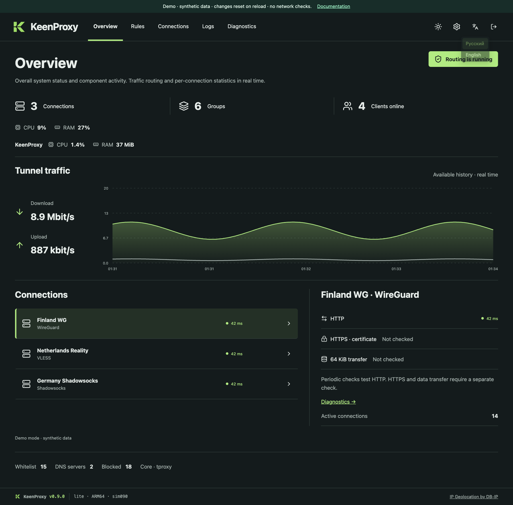
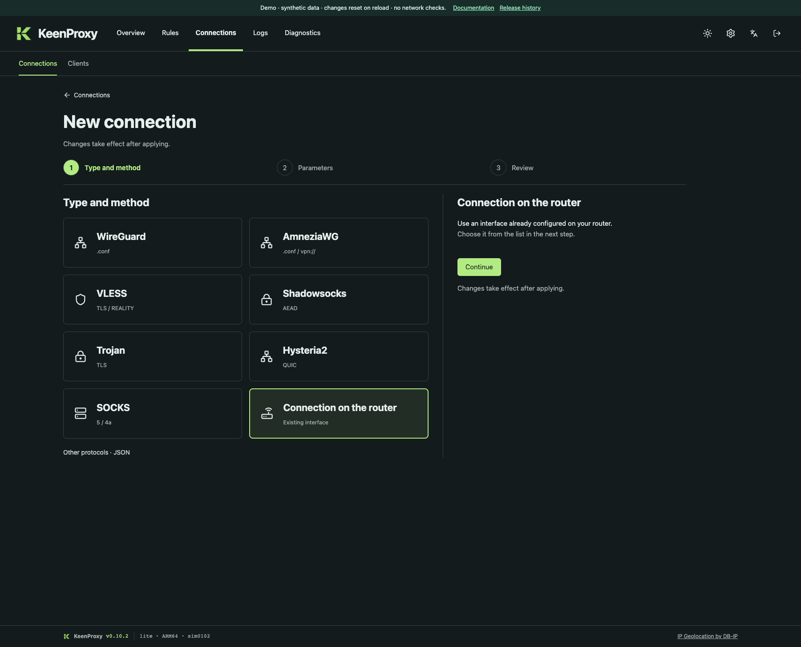

# User guide

These screenshots show the same Vue screens shipped by KeenProxy, running in the independent browser demo. Addresses, counters, profiles, and results are synthetic. The guide covers the implemented interface, rather than promising every feature shown in historical mockups.

## Access the panel

After a successful installation or command-line update, the installer prints the panel URL. Open it from your LAN. To display the current login token, run this command in the router's Entware shell:

```sh
keenproxy --key
```

Paste the token into the sign-in form. Treat it as a password: do not include it in screenshots, support reports or shared terminal output. The installer does not print the token automatically.

You can display the URL again with `keenproxy --url`. Both commands read the existing configuration without starting the daemon or changing its settings. `--key` reads the configured `api.token_file`; it does not create or rotate a missing token. For a non-default configuration:

```sh
keenproxy --key --config /path/to/config.yaml
keenproxy --url --config /path/to/config.yaml
```

The URL follows `api.listen`; wildcard listeners use an address from the configured LAN interface. If that interface has no usable address, no address is guessed. A loopback listener remains accessible only from the router or through a suitable SSH tunnel. See [installation and updates](getting-started.md#install-or-update-from-github).

## 1. Read the overview

Open **Overview** to see connection health, recent traffic, and the router's CPU and memory usage. The first resource row covers the whole router. The **KeenProxy** row shows its share of total router CPU time and its resident memory (RSS). This includes embedded sing-box. An external TrustTunnel client is measured by the router totals. When a new release is available, follow its notice to **Settings**. Traffic graphs describe observed activity and cannot establish whether traffic leaks.



## 2. Configure a connection

Open **Connections**. Select a profile to inspect its settings and status. Choose **Add** to use the wizard: import a supported connection link/file or enter a supported protocol manually. Use a descriptive name and inspect the proposed protocol and endpoint before accepting.

The file picker accepts `.conf`, `.txt`, `.json`, and `.vpn` up to 2 MiB. For a sing-box file with multiple profiles, choose the outbound or endpoint to import. Router DNS and routes stay under KeenProxy control. In **Failover**, choose the immediate backup and review the inherited chain. Connection parameters stay hidden until you reveal them. See [how failover works](routing.md#fallback-chains).

Changes enter the shared draft. Real credentials belong only in your local management session. In the browser demo, use synthetic values.

Use the connection's **Enabled** switch to pause it without deleting its profile, credentials, or routing references. The switch changes the draft only; the running connection changes after **Apply**, and **Discard** restores the saved state. A disabled connection stays visible and editable, but its tunnel/client and availability checks do not run.

Groups, devices, networks, and DNS settings keep their references to a disabled connection. Traffic follows its configured enabled fallback chain; with no enabled fallback it is blocked, not silently routed directly or passed to the next rule. An explicitly configured **Direct** fallback remains intentional. DNS keeps its separate strict/direct failure policy: disabling a connection must not create a direct DNS path in strict mode.

Raw sing-box profiles keep their `detour` and selector references to the configured connection ID. When that connection is disabled, its runtime relay uses the same enabled fallback chain, or blocks if none is available; the saved raw profile is not rewritten.

**Traffic by host** ranks the selected connection's destinations by received traffic since KeenProxy started. It shows the 10 busiest hosts first; when more match, choose **Show all** to load the full list. Search filters the ranking and keeps the chosen view; selecting another connection returns to the top 10. The table refreshes every 5 seconds.




### AmneziaWG profiles (experimental lx build)

Import a single-peer AmneziaWG `.conf` file or paste its contents in the connection wizard. AWG fields select **AmneziaWG** automatically; you can also select the AmneziaWG protocol explicitly. The original profile stays in the shared draft and can be edited before **Apply**. Keep it private: it contains the tunnel's private key and may contain a preshared key.

This build embeds [sing-box-lx 1.14.4-lx.35](https://github.com/Leadaxe/sing-box-lx/releases/tag/v1.14.4-lx.35). It supports AWG 2/3 client parameters and application TCP/UDP through a userspace WireGuard endpoint; the outer tunnel uses UDP. No kernel AWG module or additional daemon is required. Unsupported fields, executable hooks and multiple peers are rejected instead of being silently discarded.

For a standalone Amnezia `vpn://` client export, choose **AmneziaWG → Paste .conf / vpn://**, paste the complete link, enter a name and ID, and validate. You can also upload a text or `.vpn` file containing the link. Decoding happens locally in KeenProxy's backend, without contacting Amnezia or registering a device. If the export contains several AWG profiles, select one explicitly and validate again before saving it to the draft. Only the selected AWG client configuration is retained; SSH credentials, source-envelope metadata, DNS policy and other protocols are not imported. The static browser-only demo cannot decode these exports.

Compressed and uncompressed standalone exports with supported format versions (missing, 0 or 1) are accepted. The encoded URI is limited to 2 MiB and decoded JSON to 1 MiB. An export may contain at most 32 AWG candidates, with at most 1 MiB of native profile text in total; an over-limit export is rejected as a whole, without partial import. Damaged exports, unsupported protocol options, service/subscription keys and administrator-only exports without client keys are rejected. A `vpn://` link is not necessarily a ready-to-use tunnel: obtain a **client connection export**, not a subscription activation key.

To bound router memory use, junk bursts are limited to 256 packets and 1 MiB of worst-case payload per handshake. The same budget applies to native AWG profiles and core-decoded raw WireGuard endpoints.

The profile's `DNS` setting does not replace KeenProxy DNS settings. Existing routing rules and failover still select the connection; `AllowedIPs` does not install system routes. Application UDP requires **TPROXY** interception. The existing participant **UDP/443 rejection remains enabled**, so importing AWG does not enable client QUIC traffic. Amnezia subscription activation, server provisioning and service API integration are not supported.

For YAML configuration, store the profile as a block scalar:

```yaml
connections:
  - id: awg
    name: AmneziaWG
    type: amneziawg
    amneziawg: |
      [Interface]
      PrivateKey = <client-private-key-base64>
      Address = 10.77.0.2/32
      Jc = 3
      Jmin = 40
      Jmax = 80
      S1 = 20
      S2 = 30
      H1 = 1001
      H2 = 1002
      H3 = 1003
      H4 = 1004
      [Peer]
      PublicKey = <server-public-key-base64>
      Endpoint = vpn.example.com:51820
      AllowedIPs = 0.0.0.0/0
```

Replace the placeholders and obfuscation values with those exported by your server. Before rolling back to an official-sing-box build, remove or replace AmneziaWG connections in the draft and Apply: the older engine cannot use this profile type.

### sing-box-lx compatibility

Both builds support XHTTP and native TrustTunnel alongside existing VLESS, REALITY and AWG. Import server-exported links through the connection wizard or paste a raw sing-box outbound in **sing-box JSON**. Saving a connection only updates the shared draft; use the global **Apply** action to validate and activate it.

VLESS links retain their `encryption` setting instead of silently discarding it. REALITY's hybrid key exchange and VLESS encryption are different mechanisms; neither adds support for Xray's `pqv` signatures or `spiderX`. Use parameters matching the server rather than enabling encryption arbitrarily.

Supported link parameters include:

| Feature | Parameters |
| --- | --- |
| XHTTP | `type=xhttp` or `splithttp`, `host`, `path`, `mode=auto/packet-up/stream-up/stream-one`, URL-encoded `extra` JSON and `xmux` |
| VLESS encryption | `encryption=mlkem768x25519plus.…`; `none` leaves this layer disabled |
| REALITY | `key_share=hybrid` or `classical` (alias `keyShare`), alongside `pbk`, `sid`, `sni` and `fp` |
| TLS fragmentation | Explicit boolean `fragment`, `record_fragment` (alias `recordFragment`), and duration `fragment_fallback_delay` (alias `fragmentFallbackDelay`) |

Malformed flags, unsupported XHTTP options, non-empty `pqv`/`fm` and custom `spx` values fail import. Raw sing-box JSON remains available for engine-supported options without a share-link mapping; Apply performs engine validation.

XHTTP (`type=xhttp` or `splithttp`) with `flow=xtls-rprx-vision` requires an enabled VLESS `encryption` layer. Links with this combination and missing or `none` encryption are rejected at import; TLS/REALITY alone does not make it compatible. Encrypted XHTTP/Vision profiles remain supported.

The full build includes QUIC/HTTP/3. Lite keeps TCP/TLS transports, including XHTTP over HTTP/1.1 or HTTP/2 and TrustTunnel over HTTP/2; HTTP/3-only profiles require the full build. This engine-side transport choice does not change participant UDP/443 interception policy.

TrustTunnel uses `type: link` with the complete exported `tt://?…` link. Legacy `type: trusttunnel` sections are normalized when loaded and saved in the link representation on Apply; `binary` and `socks_port` no longer control a process. Previously installed external clients are left untouched but are not used. Keep an old configuration backup before migration if you need to return to an external-client build.

Upgrades and `--uninstall` leave legacy `bin/trusttunnel_client` and `share/keenproxy/trusttunnel/` files under the installation prefix (normally `/opt`). After confirming that the native connection works, remove these files manually only if no other service uses them and you no longer need an external-client rollback. Back up the old configuration first; generated client files may contain credentials.

The status API no longer returns the `trusttunnel` external-process field. External consumers must stop requiring that field; the native outbound does not have a separately supervised client process.

```yaml
connections:
  - id: tt
    name: TrustTunnel
    type: link
    link: "tt://?REPLACE_WITH_EXPORTED_LINK"
```

The placeholder is not a usable credential. TLS certificate verification stays enabled unless the imported profile explicitly disables it. If an exported option cannot be represented by the embedded implementation, import reports an error rather than silently weakening the profile.

Native TrustTunnel import rejects client-random authentication fields, subscription URLs, differing address ports and unsupported transports. Same-port IP lists use one address (IPv4 preferred), not the external client's address racing. HTTP/2 anti-DPI maps to TLS fragmentation; its packet timing is not identical to the external client. HTTP/3 with anti-DPI is rejected. Link DNS settings do not replace KeenProxy's DNS ownership.

For a link listing several IP addresses on the same port, import selects the first IPv4 address in exported order, otherwise the first IP address. The remaining addresses are not retained as automatic fallbacks: if the selected endpoint fails, the embedded client does not try the other exported addresses.

When certificate verification is enabled, `custom_sni` must match the exported `hostname` (case and a trailing dot are ignored). The native TLS schema cannot transmit one SNI while verifying a different hostname; such profiles are rejected rather than authenticating the wrong identity. This does not automatically disable verification.


## 3. Add a routing group

Open **Rules → Whitelist**. Create a group, name it, select its target connection (or **Direct**/**Block**), and add domains or addresses. For example, direct `work.example.com` to the Netherlands profile. Review imported entries before confirming; country selectors express broader policies.

Use `ru`, `.ru`, or `*.ru` to match the entire `.ru` domain suffix. All three match `ru` itself and names such as `example.ru`, but not `guru` or `example.ru.com`. This matches domain names, not the country of an IP address.
The entry editor shows which entire zones will match before you save the draft. A single label consisting only of digits (such as `10`) is not a valid suffix; enter a full IP address or CIDR prefix to match by address.

To move several domain or country groups together, select their checkboxes, choose a target in **Change route**, and review the preview. Groups hidden by a filter can still be selected. Choose **Save to draft**, then **Apply** when ready.

Expand an entry to see its current DNS observations and expiration. A resolved address alone does not prove that application traffic followed the intended tunnel.

Use the on/off switches to pause an entire group or an individual domain/IP rule without removing its value. Country/category groups also have group and per-selector switches. Disabled items remain visible; the active/total counts distinguish saved rules from effective rules. Turning a group off preserves its children's individual states, so turning it on again does not re-enable rules you had paused separately.

An off group or rule is skipped, not blocked: the remaining rules and device policy determine the route. In particular, disabling a block rule stops that rule from blocking. Off domain rules do not contribute active DNS rule sets or initiate background resolution. A country/category group with no active selectors is inactive even in **All except** mode; it never becomes a match-all rule. Review the shared draft and **Apply** to change live behavior.

In YAML, connection and group switches use `disabled: true`. Per-rule states are retained in `disabled_entries`, `disabled_countries`, and `disabled_categories`; the original entries/selectors remain present. Missing fields preserve the previous enabled behavior. Older releases reject unknown activation fields: prepare and validate a compatible configuration before downgrading. Removing the fields re-enables the corresponding items, so review the resulting routes first.


See [Country rules](routing.md#country-rules) for an illustrated setup, country exclusions, and rule precedence.

## 4. Try a preset

Open **Rules → Presets**, select a target, then preview a collection. Inspect the added/removed entries and accept it into the draft. Presets can be enabled, disabled, or removed. The static demo includes one original example collection; it does not redistribute the full community catalog.

The catalog shows domain lists without resolving them. KeenProxy resolves IPs for enabled presets after **Apply**. Enable **Update with new app versions** to adopt changes to the bundled preset after upgrading KeenProxy. To block ads or other domains through DNS, see [DNS filters](routing.md#dns-filters).

Updating a preset preserves per-entry off states separately from deletions, including entries that disappear from one preset revision and return later. Disabling a rule does not remove it from the preset or discard your saved value.

### Exchange resource lists { #resource-lists }

Import a local file into a new or existing explicit-resource group or local preset. Choose append to keep existing entries or replace to remove entries absent from the file. Inspect duplicates, additions, removals, and diagnostics before staging the result. Invalid or unsupported rules block the whole import. **Apply** saves the draft; **Discard** restores the last saved configuration.

Local presets are reusable resource lists, separate from the bundled catalog. They do not change routing until you copy their entries into a group and apply the draft.

| Format | Representation |
| --- | --- |
| TXT | One domain suffix, IP address, or CIDR per line; blank lines and `#` comments are allowed. |
| CSV | UTF-8 `type,value` columns. Use `domain_suffix,example.com` or `ip_cidr,192.0.2.0/24`. |
| KeenProxy JSON | `{"version":1,"name":"Example","entries":[{"type":"domain_suffix","value":"example.com","disabled":true}]}`. Only this format preserves resource activation and the optional list name. |
| sing-box JSON / binary SRS | Import versions 1–5 for supported rules. Export version 2 for compatibility with sing-box 1.10 and later. Example source: `{"version":2,"rules":[{"domain_suffix":["example.com"]},{"ip_cidr":["2001:db8::/32"]}]}`. |

Only equivalent sing-box rules can be imported. An exact domain by itself does not match subdomains, and a leading-dot suffix by itself does not match the apex. Both are rejected unless another imported rule covers the missing part without widening the result. Logical rules, inversion, regex, keywords, and source or port filters are unsupported. An existing SRS file may already have combined adjacent CIDRs; import recovers the encoded address set, not the original source text. KeenProxy's SRS export preserves separate editable prefixes. This is not a configuration backup: connection settings, routing targets, country/category selectors, and catalog provenance are not exported. Review conversion losses before downloading; a format without activation flags omits disabled resources.

Files are limited to 2 MiB and 20,000 input entries; binary validation also bounds decompression and expansion. An export outside these limits is rejected rather than producing a file that KeenProxy cannot reimport. A local preset can hold up to 20,000 entries. The router stores up to 64 local presets and at most 40,000 combined values or 1 MiB of resource text, including disabled markers. Suffixes that would be stored as IP addresses, such as `*.192.0.2.1`, are not representable.

## 5. Choose devices and networks

Open **Connections → Clients**. Network defaults apply to matching subnets; per-device entries let you select a policy for individual clients. **Split** uses selective rules, **Full** selects a default connection, and **Off** bypasses KeenProxy interception for that policy. Review both the device and network settings before Apply. When available, the device row also shows a discovered hostname and its DHCP/DNS source. A manually assigned name takes priority; searching matches either name. Discovery refreshes in the background and does not write names to configuration.


## 6. Review and Apply

The change bar appears whenever the draft differs from the saved configuration. Review changes across screens, then choose **Apply** once. Wait for success. If validation/application fails, read the error and correct the draft. **Discard** restores the last saved snapshot.


## 7. Verify the result

Open **Diagnostics** to see core uptime, applied configuration, interception, DNS settings, GeoIP, and the firewall restoration counter. Select an applied connection and choose **Run checks** to test HTTP, HTTPS with certificate verification, and a 64 KiB transfer separately. A new or edited profile must be applied first. The results leave the active failover selection unchanged. The DNS row describes the configured path. Use [a test from the affected device](network-flow.md#how-to-trace-one-request) to verify the actual path. The browser demo labels its check results as simulated and hides the ZIP download button.


### Export journals and diagnostics { #export-journals }

On the router, open **Diagnostics → Diagnostics archive → Download ZIP**. See [what each download contains and what to review before sharing](troubleshooting.md#download-the-diagnostic-zip).

Watchdog recovery events include the failed firewall check and the verification result. The ZIP retains safe structured evidence. See [watchdog diagnostics](troubleshooting.md#why-does-the-watchdog-restore-interception-rules).

### Inspect one routing decision

Open **Logs** and switch between **Routing**, **Audit**, and **System**. In **Routing**, **Group repeats** combines matching loaded records in 30-second windows. Expand a group to see its members or clear the checkbox for individual entries. Search and filters narrow the view. A routing record explains which outbound was selected. Check the application separately to confirm that the connection and transfer succeeded. New routing records in the browser demo are generated locally by the simulation.


## 8. Find settings and manage backups

Open **Settings** with the gear icon. On narrow screens, choose a section from the dropdown. **DNS** opens by default. Use **YAML configuration** to manage backups. Use **Network and interception** for REDIRECT/TPROXY and interfaces, **Panel access** for the listener, token path, and trusted networks, and **Country databases** for GeoIP status. Use **Language and theme** for browser preferences. Routing and access changes use the shared **Apply** action. Changing the panel listener or token file also requires a service restart. **Updates** has its own controls.

Open **Settings → DNS** to choose the primary DNS server. The secondary is optional; clear its selection to remove it. Choose a provider and protocol from the list or select **Custom DNS server** and enter an IP address or a DoH, DoT, or UDP URL. The provider list includes Cloudflare, Google Public DNS, Quad9, AdGuard, Yandex DNS, Cisco OpenDNS, CleanBrowsing, and Control D. Each choice shows its filtering policy. KeenProxy tries the primary first and uses the secondary, if configured, when the primary is unavailable. The two servers must be different. **Advanced settings** contains any additional resolvers, bootstrap addresses, and the listening address. The DNS route and tunnel failure policy are configured separately. Imported YAML can also list just one server in `dns.upstreams`.

If you clear **Secondary DNS** while additional servers are configured, the first additional server moves into that slot. The other servers keep their priority order. To keep only the primary, remove all additional servers before clearing the secondary, then choose **Apply**.

If a LAN DNS forwarder's own queries are being redirected back to it, open **Advanced settings → Bypass DNS interception for source IPs**, add the forwarder's own IPv4 address (not its upstream's address), and choose **Apply**. To restore interception, remove the address and Apply again. See [DNS interception exceptions](routing.md#dns) for the YAML key and scope.

Open **Settings → YAML configuration** to import, export, or restore a configuration. Importing or restoring prepares a draft. Review it and Apply. Keep unredacted backups private. The browser demo exports synthetic JSON-compatible data and disables YAML import.

The panel accepts YAML backup files up to 3 MiB for preview and processes only one file conversion at a time. Applying the resulting draft still requires it to fit the 8 MiB configuration request limit. A larger full backup can exceed the panel's restore limit.

### Soft memory limit

Open **Settings → System** only if the router is running short of memory. **Soft Go memory limit, MiB** is an optional recommendation for the Go runtime, covering KeenProxy and its embedded sing-box. Lowering it makes garbage collection more frequent, increases CPU usage, and may reduce connection speed. Leave it empty if the router has no memory problems.

This is not a hard cap on process RSS and does not include all memory used by the operating system. Go may exceed the recommendation; leave room for the router firmware, network buffers, and other services. See the [Go memory-limit guide](https://go.dev/doc/gc-guide#Memory_limit).

Use the shared **Apply** button to save and activate the value. A memory-only change does not require restarting the service or sing-box; the saved setting is also applied at startup. An empty field uses the Go limit set before daemon startup, including `GOMEMLIMIT`; if no limit was set, KeenProxy uses **768 MiB (805306368 bytes)**. An explicit value in the panel takes priority. Clearing the field and applying restores this default mode. An explicitly supplied `GOMEMLIMIT=off` is respected and keeps the inherited mode unlimited.

For example, an explicit recommendation of 400 MiB is stored as:

```yaml
system:
  memory_limit_mib: 400
```

Only positive whole MiB values are accepted. To remove the override, omit `memory_limit_mib`, rather than setting it to zero. The demo saves this setting in memory without imposing a real process limit.

## 9. Install or roll back a release

The panel footer shows the running release and build variant, architecture, and short commit hash. A local build may lack a release tag or commit hash. **Settings → Updates** also shows the available update and the previous version when known. **Diagnostics → Build details** lets you copy the running build identity. The diagnostics ZIP includes the same information in `status.json`.

Open **Settings → Updates**. Apply or discard any routing draft before installing or rolling back. Confirm the version and wait for the service to reconnect. You can save a time for automatic installation or leave it off and install releases when ready. See [the update guide](getting-started.md#update-from-the-panel) for first-time setup and rollback requirements.
