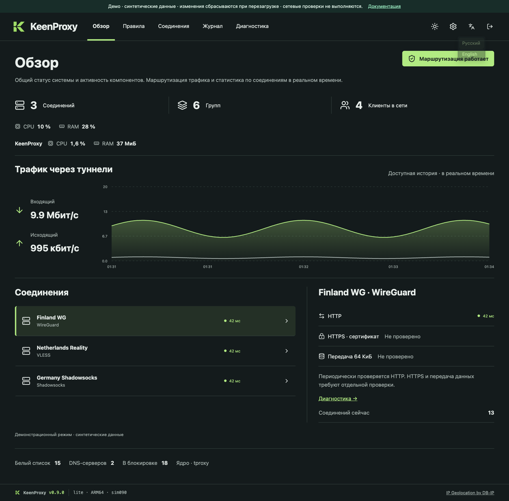
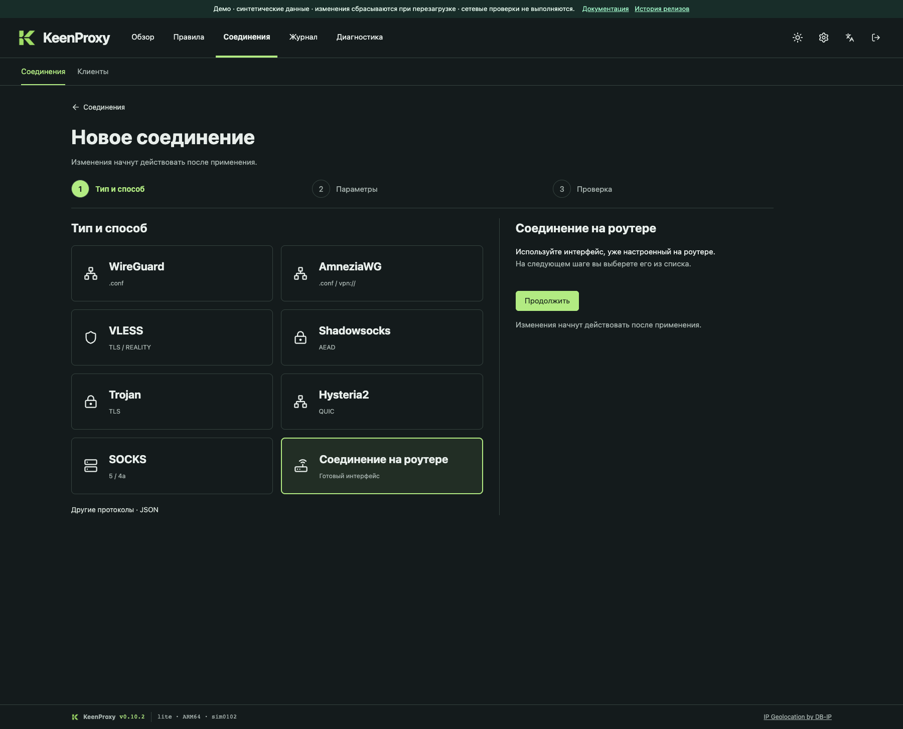

# Руководство пользователя

На скриншотах — те же Vue-экраны, которые входят в KeenProxy, запущенные в отдельном браузерном демо. Адреса, счётчики, профили и результаты синтетические. Руководство описывает реализованный интерфейс, а не обещает все возможности исторических макетов.

## Как открыть панель { #access-the-panel }

После успешной установки или обновления из командной строки установщик выводит URL панели. Откройте его из локальной сети. Чтобы получить текущий токен входа, выполните в оболочке Entware на роутере:

```sh
keenproxy --key
```

Вставьте токен в форму входа. Обращайтесь с ним как с паролем: не включайте его в скриншоты, отчёты поддержки и общий вывод терминала. Установщик не печатает токен автоматически.

Повторно узнать URL можно командой `keenproxy --url`. Обе команды читают существующий конфиг, не запускают службу и не меняют настройки. `--key` читает заданный `api.token_file`, не создаёт и не заменяет отсутствующий токен. Для нестандартного конфига:

```sh
keenproxy --key --config /path/to/config.yaml
keenproxy --url --config /path/to/config.yaml
```

URL учитывает `api.listen`; для прослушивания всех адресов используется адрес настроенного LAN-интерфейса. Если подходящего адреса нет, команда не подставляет выдуманный. При привязке к loopback панель доступна только с роутера или через подходящий SSH-туннель. См. [установку и обновление](getting-started.md#install-or-update-from-github).

## 1. Посмотрите обзор

Откройте **Обзор**. Здесь видны состояние соединений, текущий трафик, загрузка CPU и занятая память всего роутера. Строка **KeenProxy** показывает долю процессорного времени всего роутера и резидентную память процесса (RSS). В эти цифры входит встроенный sing-box. Расход внешнего клиента TrustTunnel виден в общих показателях роутера. Когда доступен новый релиз, уведомление ведёт в **Настройки**. Графики показывают наблюдаемую активность и не позволяют определить, есть ли утечки.



## 2. Настройте соединение

Откройте **Соединения**. Выберите профиль, чтобы посмотреть параметры и состояние. Нажмите **Добавить** для открытия мастера: импортируйте поддерживаемую ссылку/файл или задайте поддерживаемый протокол вручную. Выберите понятное имя, проверьте протокол и адрес сервера перед подтверждением.

Мастер принимает `.conf`, `.txt`, `.json` и `.vpn` размером до 2 МиБ. Если в файле sing-box несколько профилей, выберите нужный outbound или endpoint. DNS и маршруты роутера остаются под управлением KeenProxy. В разделе **Резервирование** выберите ближайший резерв и проверьте унаследованную цепочку. Параметры подключения скрыты, пока вы явно их не откроете. См. [как работает резервирование](routing.md#fallback-chains).

Изменения попадают в общий черновик. Настоящие реквизиты следует вводить только в локальном сеансе управления своим роутером. В браузерном демо используйте синтетические значения.

Переключатель **Включено** позволяет приостановить соединение, не удаляя профиль, реквизиты и ссылки из правил. Он меняет только черновик: действующее соединение изменится после **Применить**, а **Отменить** вернёт сохранённое состояние. Отключённое соединение остаётся видимым и доступным для редактирования, но его туннель/клиент и проверки доступности не запускаются.

Группы, устройства, сети и настройки DNS сохраняют ссылки на отключённое соединение. Трафик идёт по его цепочке включённых резервов; если подходящего резерва нет, он блокируется, а не отправляется напрямую или к следующему правилу. Явно настроенный резерв **Напрямую** сохраняет свой смысл. DNS использует отдельную политику strict/direct: отключение соединения не должно открывать прямой путь DNS в строгом режиме.

Raw-профили sing-box сохраняют ссылки `detour` и селекторов на настроенный ID соединения. Если соединение отключено, его runtime-посредник использует ту же цепочку включённых резервов или блокирует трафик при их отсутствии; сохранённый raw-профиль не переписывается.

**Трафик по хостам** упорядочивает адресатов выбранного соединения по полученному трафику с запуска KeenProxy. Сначала показываются 10 самых активных хостов; если подходящих больше, нажмите **Показать все**, чтобы загрузить полный список. Поиск фильтрует рейтинг и сохраняет выбранный вид; при выборе другого соединения снова показываются первые 10. Таблица обновляется каждые 5 секунд.




### Профили AmneziaWG (экспериментальная сборка lx)

Импортируйте однопировый `.conf` AmneziaWG или вставьте его содержимое в мастер соединений. При наличии AWG-полей автоматически выбирается **AmneziaWG**; протокол можно выбрать и вручную. Исходный профиль остаётся в общем черновике, его можно отредактировать перед **Применить**. Храните его приватно: внутри есть закрытый ключ туннеля и может быть предварительно согласованный ключ.

Эта сборка использует [sing-box-lx 1.14.4-lx.35](https://github.com/Leadaxe/sing-box-lx/releases/tag/v1.14.4-lx.35). Поддерживаются клиентские параметры AWG 2/3 и TCP/UDP приложений через userspace-endpoint WireGuard; внешний туннель использует UDP. Модуль AWG в ядре и отдельный демон не нужны. Неподдерживаемые поля, исполняемые команды и несколько пиров отклоняются, а не теряются при импорте.

Для автономного клиентского экспорта Amnezia `vpn://` выберите **AmneziaWG → Вставить .conf / vpn://**, вставьте ссылку целиком, задайте имя и ID, затем проверьте параметры. Можно также загрузить текстовый файл или `.vpn` со ссылкой. KeenProxy декодирует её локально на backend, не обращаясь к Amnezia и не регистрируя устройство. Если внутри несколько AWG-профилей, явно выберите один и повторите проверку перед сохранением в черновик. Сохраняется только выбранная клиентская конфигурация AWG; SSH-реквизиты, метаданные оболочки, политика DNS и другие протоколы не импортируются. Статическое браузерное демо такие экспорты не декодирует.

Поддерживаются сжатые и несжатые автономные экспорты с допустимой версией формата (отсутствует, 0 или 1). Размер закодированной ссылки ограничен 2 МиБ, декодированного JSON — 1 МиБ. В одном экспорте допускается не более 32 кандидатов AWG и не более 1 МиБ нативных профилей суммарно; при превышении лимита экспорт отклоняется целиком, без частичного импорта. Повреждённые экспорты, неподдерживаемые параметры протокола, ключи сервиса/подписки и административные экспорты без клиентских ключей отклоняются. Ссылка `vpn://` не обязательно содержит готовый туннель: нужен **экспорт клиентского подключения**, а не ключ активации подписки.

Для ограничения расхода памяти роутера junk-серия ограничена 256 пакетами и 1 МиБ полезной нагрузки на одно рукопожатие в худшем случае. Ограничение действует для нативных профилей AWG и raw-endpoint WireGuard после декодирования параметров ядром.

Поле `DNS` профиля не заменяет настройки DNS KeenProxy. Соединение по-прежнему выбирают существующие правила и failover; `AllowedIPs` не устанавливает системные маршруты. Для UDP приложений нужен перехват **TPROXY**. Существующее **отклонение UDP/443 участвующих клиентов сохраняется**: импорт AWG не включает клиентский QUIC. Активация подписок Amnezia, настройка серверов и интеграция с API сервиса не поддерживаются.

В YAML сохраните профиль многострочной строкой:

```yaml
connections:
  - id: awg
    name: AmneziaWG
    type: amneziawg
    amneziawg: |
      [Interface]
      PrivateKey = <client-private-key-base64>
      Address = 10.77.0.2/32
      Jc = 3
      Jmin = 40
      Jmax = 80
      S1 = 20
      S2 = 30
      H1 = 1001
      H2 = 1002
      H3 = 1003
      H4 = 1004
      [Peer]
      PublicKey = <server-public-key-base64>
      Endpoint = vpn.example.com:51820
      AllowedIPs = 0.0.0.0/0
```

Замените заполнители и параметры обфускации значениями из экспорта своего сервера. Перед откатом на сборку с официальным sing-box удалите или замените соединения AmneziaWG в черновике и примените изменения: старый движок не поддерживает этот тип профиля.

### Совместимость sing-box-lx { #sing-box-lx-compatibility }

Обе сборки поддерживают XHTTP и встроенный TrustTunnel наряду с существующими VLESS, REALITY и AWG. Импортируйте экспортированные сервером ссылки через мастер соединений или вставьте готовый sing-box outbound на вкладке **sing-box JSON**. Сохранение соединения меняет только общий черновик; для проверки и запуска используйте глобальную кнопку **Применить**.

Ссылки VLESS сохраняют параметр `encryption`, а не отбрасывают его. Гибридный обмен ключами REALITY и шифрование VLESS — разные механизмы; ни один не добавляет поддержку подписей Xray `pqv` или `spiderX`. Используйте параметры своего сервера, а не включайте шифрование произвольно.

Поддерживаемые параметры ссылок:

| Возможность | Параметры |
| --- | --- |
| XHTTP | `type=xhttp` или `splithttp`, `host`, `path`, `mode=auto/packet-up/stream-up/stream-one`, URL-кодированный JSON `extra` и `xmux` |
| Шифрование VLESS | `encryption=mlkem768x25519plus.…`; `none` отключает этот слой |
| REALITY | `key_share=hybrid` или `classical` (алиас `keyShare`), вместе с `pbk`, `sid`, `sni` и `fp` |
| Фрагментация TLS | Явные булевы значения `fragment`, `record_fragment` (алиас `recordFragment`) и длительность `fragment_fallback_delay` (алиас `fragmentFallbackDelay`) |

Некорректные флаги, неподдерживаемые опции XHTTP, непустые `pqv`/`fm` и нестандартные значения `spx` отклоняются при импорте. Для опций движка без преобразования из ссылки остаётся готовый sing-box JSON; при применении его проверяет движок.

Для XHTTP (`type=xhttp` или `splithttp`) с `flow=xtls-rprx-vision` нужен включённый слой VLESS `encryption`. Ссылки с таким сочетанием без encryption или с `encryption=none` отклоняются при импорте; одного TLS/REALITY недостаточно. Профили XHTTP/Vision с включённым шифрованием остаются поддерживаемыми.

Полная сборка включает QUIC/HTTP/3. Lite сохраняет TCP/TLS-транспорты, в том числе XHTTP через HTTP/1.1 или HTTP/2 и TrustTunnel через HTTP/2; профили только с HTTP/3 требуют полной сборки. Этот выбор транспорта движка не меняет политику перехвата клиентского UDP/443.

TrustTunnel использует `type: link` и полную экспортированную ссылку `tt://?…`. Старые секции `type: trusttunnel` преобразуются при загрузке и сохраняются как ссылки при применении; `binary` и `socks_port` больше не управляют отдельным процессом. Ранее установленные внешние клиенты не удаляются, но больше не используются. Перед миграцией сохраните старый конфиг, если нужен откат на сборку с внешним клиентом.

Обновление и `--uninstall` оставляют старые файлы `bin/trusttunnel_client` и `share/keenproxy/trusttunnel/` внутри каталога установки (обычно `/opt`). Убедившись, что встроенное соединение работает, удалите их вручную, только если они не используются другими сервисами и больше не нужны для отката на внешний клиент. Сначала сохраните старую конфигурацию; сгенерированные файлы клиента могут содержать реквизиты доступа.

API состояния больше не возвращает поле `trusttunnel` со статусом внешнего процесса. Внешние потребители должны перестать требовать это поле: у встроенного outbound нет отдельного управляемого клиентского процесса.

```yaml
connections:
  - id: tt
    name: TrustTunnel
    type: link
    link: "tt://?REPLACE_WITH_EXPORTED_LINK"
```

Заполнитель не является рабочими реквизитами. Проверка сертификата TLS включена, если импортируемый профиль явно не отключает её. Если параметр экспорта невозможно представить во встроенной реализации, импорт возвращает ошибку, а не ослабляет настройки молча.

Встроенный импорт TrustTunnel отклоняет поля аутентификации client-random, URL подписок, разные порты в списке адресов и неподдерживаемые транспорты. Для IP с одинаковым портом выбирается один адрес (предпочтительно IPv4), без параллельных попыток внешнего клиента. Anti-DPI для HTTP/2 преобразуется во фрагментацию TLS; тайминги пакетов не идентичны внешнему клиенту. HTTP/3 с anti-DPI отклоняется. DNS-настройки ссылки не заменяют DNS KeenProxy.

Если ссылка содержит несколько IP-адресов с одинаковым портом, импорт выбирает первый IPv4 в порядке экспорта, иначе первый IP-адрес. Остальные адреса не сохраняются как автоматические резервные: при отказе выбранного узла встроенный клиент не перебирает другие адреса из ссылки.

При включённой проверке сертификата `custom_sni` должен совпадать с экспортированным `hostname` (регистр и завершающая точка не учитываются). Схема встроенного TLS не позволяет передавать одно SNI и проверять другое имя; такие профили отклоняются, а не проверяются относительно другой identity. Проверка сертификата автоматически не отключается.


## 3. Добавьте группу маршрутизации

Откройте **Правила → Белый список**. Создайте группу, задайте имя, выберите целевое соединение либо **Напрямую**/**Блокировать**, добавьте домены или адреса. Например, направьте `work.example.com` через профиль Netherlands. Проверьте импортируемые записи перед подтверждением; выбор стран задаёт более широкую политику.

Чтобы сменить маршрут нескольких доменных групп или групп стран, отметьте их флажками, выберите цель в панели **Изменить маршрут** и проверьте список. Скрытые фильтром группы могут оставаться выбранными. Нажмите **Сохранить в черновик**, затем **Применить**.

Раскройте запись, чтобы посмотреть DNS-наблюдения и срок действия адресов. Наличие IP само по себе не доказывает, что трафик приложения прошёл через нужный туннель.

Переключатели позволяют приостановить целую группу или отдельное правило домена/IP, не удаляя значение. У групп стран/категорий есть переключатели группы и отдельных условий. Отключённые элементы остаются видимыми, а счётчики активных и всех правил показывают разницу между сохранёнными и действующими правилами. Выключение группы сохраняет индивидуальные состояния внутри: при включении отдельно приостановленные правила не включаются автоматически.

Выключенная группа или правило пропускается, а не блокируется: маршрут определяют оставшиеся правила и политика устройства. В частности, отключённое правило блокировки перестаёт блокировать. Выключенные доменные правила не участвуют в действующих наборах DNS-правил и не инициируют фоновое разрешение адресов. Группа стран/категорий без активных условий не действует даже в режиме **Все, кроме** и не превращается в правило на весь интернет. Проверьте общий черновик и нажмите **Применить** для изменения действующего поведения.

В YAML переключатели соединения и группы используют `disabled: true`. Состояния отдельных правил сохраняются в `disabled_entries`, `disabled_countries` и `disabled_categories`; исходные записи и условия остаются на месте. При отсутствии этих полей прежнее поведение сохраняется. Старые версии отклоняют неизвестные поля состояний: перед откатом подготовьте и проверьте совместимую конфигурацию. Удаление полей включает соответствующие элементы обратно, поэтому сначала проверьте получающиеся маршруты.


Настройка с иллюстрациями, исключениями стран и приоритетом правил описана в разделе [Правила по странам](routing.md#country-rules).

## 4. Попробуйте пресет

Откройте **Правила → Пресеты**, выберите маршрут и предпросмотр набора. Изучите добавляемые/удаляемые записи и перенесите результат в черновик. Пресеты можно включать, выключать и удалять. Статическое демо содержит один собственный пример набора, а не полный каталог сообщества.

Каталог показывает состав пресетов без DNS-запросов. KeenProxy разрешает адреса включённых пресетов после нажатия **Применить**. Флажок **Обновлять состав с новой версией приложения** позволяет принять изменения встроенного пресета после обновления KeenProxy. Блокировка рекламы и других доменов описана в разделе [DNS-фильтры](routing.md#dns-filters).

Обновление пресета сохраняет состояния отдельных выключенных записей отдельно от удалений, в том числе если запись исчезает из одной версии пресета и возвращается позже. Отключение правила не удаляет его из пресета и не теряет сохранённое значение.

### Обмен списками ресурсов { #resource-lists }

Импортируйте локальный файл в новую или существующую группу явных ресурсов либо в пользовательский пресет. Выберите добавление, чтобы сохранить существующие записи, или замену, чтобы удалить записи, которых нет в файле. Перед переносом в черновик проверьте дубликаты, добавления, удаления и ошибки. Неверные или неподдерживаемые правила блокируют импорт целиком. **Применить** сохраняет черновик, **Отменить** возвращает последнюю сохранённую конфигурацию.

Пользовательские пресеты — это списки ресурсов отдельно от встроенного каталога. Они не меняют маршрутизацию, пока вы не скопируете записи в группу и не примените черновик.

| Формат | Представление |
| --- | --- |
| TXT | По одному доменному суффиксу, IP-адресу или CIDR на строку; разрешены пустые строки и комментарии `#`. |
| CSV | Столбцы `type,value` в UTF-8. Примеры: `domain_suffix,example.com` и `ip_cidr,192.0.2.0/24`. |
| KeenProxy JSON | `{"version":1,"name":"Example","entries":[{"type":"domain_suffix","value":"example.com","disabled":true}]}`. Только этот формат сохраняет состояния записей и необязательное имя списка. |
| sing-box JSON / двоичный SRS | Импорт версий 1–5 для поддерживаемых правил. Экспорт версии 2 для совместимости с sing-box 1.10 и новее. Пример исходного файла: `{"version":2,"rules":[{"domain_suffix":["example.com"]},{"ip_cidr":["2001:db8::/32"]}]}`. |

Из sing-box импортируются только эквивалентные правила. Точный домен сам по себе не совпадает с поддоменами, а суффикс с начальной точкой сам по себе не совпадает с корневым доменом. Такие записи отклоняются, если другое правило из файла не покрывает недостающую часть без расширения результата. Логические правила, инверсия, регулярные выражения, ключевые слова и фильтры по источнику или порту не поддерживаются. В готовом SRS соседние CIDR могут быть уже объединены: при импорте восстанавливается закодированный набор адресов, а не исходный текст. При экспорте в SRS KeenProxy сохраняет отдельные редактируемые префиксы. Это не резервная копия: настройки соединений, цели маршрутизации, селекторы стран и категорий и сведения о происхождении пресета не экспортируются. Перед скачиванием проверьте потери: форматы без состояний пропускают выключенные записи.

Ограничения файла: 2 МиБ и 20 000 входных записей. Для двоичных файлов также ограничены распаковка и разворачивание правил. Экспорт за пределами этих ограничений отклоняется: KeenProxy не выдаёт файл, который не сможет импортировать. В пользовательском пресете может быть до 20 000 записей. Роутер хранит до 64 пользовательских пресетов и не более 40 000 значений или 1 МиБ текста ресурсов суммарно, включая отметки выключенных записей. Однокомпонентные суффиксы вроде `.cn` и суффиксы, которые сохранились бы как IP-адреса, например `*.192.0.2.1`, не представимы.

## 5. Выберите устройства и сети

Откройте **Соединения → Клиенты**. Настройки сети задают политику для подходящей подсети; записи устройств позволяют выбрать её для отдельных клиентов. **Раздельный** использует избирательные правила, **Полный туннель** выбирает соединение по умолчанию, **Не участвует** отключает перехват KeenProxy для этой политики. Перед применением проверьте и устройство, и сеть. Если имя доступно, строка устройства показывает обнаруженный hostname и источник DHCP/DNS. Заданное вручную имя остаётся главным; поиск учитывает оба имени. Обнаружение обновляется в фоне и не записывает имена в конфигурацию.


## 6. Проверьте и примените

Панель изменений появляется, когда черновик отличается от сохранённой конфигурации. Просмотрите правки на всех экранах и один раз нажмите **Применить**. Дождитесь успеха. При ошибке проверки/применения прочитайте сообщение и исправьте черновик. **Отменить** восстанавливает последний сохранённый снимок.


## 7. Проверьте результат

В **Диагностике** видны время работы ядра, состояние конфигурации и перехвата, настройки DNS, GeoIP и счётчик восстановлений правил firewall. Выберите применённое соединение и нажмите **Запустить проверку**, чтобы отдельно проверить HTTP, HTTPS с проверкой сертификата и передачу 64 КиБ. Новый или изменённый профиль сначала примените. Результаты проверки не меняют активный резерв. Строка DNS описывает настроенный маршрут. Фактический маршрут проверяйте [с нужного устройства](network-flow.md#how-to-trace-one-request). Браузерное демо помечает результаты проверок как синтетические и скрывает кнопку скачивания ZIP.


### Выгрузите журналы и диагностику { #export-journals }

На роутере откройте **Диагностика → Архив для диагностики → Скачать ZIP**. См. [состав выгрузок и что проверить перед отправкой](troubleshooting.md#download-the-diagnostic-zip).

### Проверьте, какое правило сработало

В **Журнале** переключайтесь между вкладками **Маршрутизация**, **Аудит** и **Система**. В **Маршрутизации** флажок **Группировать повторы** объединяет совпадающие загруженные записи в окнах по 30 секунд. Раскройте группу, чтобы увидеть записи, или снимите флажок для просмотра по одной. Поиск и фильтры сужают выборку. Запись показывает выбранный выход. Успешное подключение и передачу проверяйте отдельно в самом приложении. Новые записи в браузерном демо создаёт локальная симуляция.


События восстановления сторожа содержат неудачную проверку firewall и результат проверки после восстановления. ZIP сохраняет безопасные структурированные сведения. Подробнее в [диагностике сторожа](troubleshooting.md#why-does-the-watchdog-restore-interception-rules).

## 8. Найдите нужный раздел настроек и сделайте резервную копию

Откройте **Настройки** через значок шестерёнки. На узком экране раздел выбирается из выпадающего списка. По умолчанию открывается **DNS**. Для резервных копий есть вкладка **Конфигурация YAML**. Вкладка **Сеть и перехват** содержит режим REDIRECT/TPROXY и интерфейсы. Во вкладке **Доступ к панели** находятся адрес прослушивания, путь к токену и доверенные сети. **Базы стран** показывают состояние GeoIP, а **Язык и тема** управляют настройками браузера. Сетевые настройки и доступ к панели сохраняются через общую кнопку **Применить**. После смены адреса прослушивания панели или файла токена нужно перезапустить службу. У **Обновлений** отдельные кнопки.

Откройте **Настройки → DNS** и выберите основной сервер. Резервный сервер необязателен: чтобы удалить его, очистите выбор. Выберите провайдера и протокол из списка или откройте **Свой DNS-сервер** и введите IP-адрес либо URL для DoH, DoT или UDP. В списке есть Cloudflare, Google Public DNS, Quad9, AdGuard, Яндекс DNS, Cisco OpenDNS, CleanBrowsing и Control D. У каждого варианта указана политика фильтрации. KeenProxy сначала обращается к основному серверу и переключается на резервный, если он настроен, когда основной недоступен. Серверы должны отличаться. Дополнительные серверы, Bootstrap IP и адрес прослушивания находятся в **Дополнительных параметрах**. Маршрут DNS и поведение при отказе туннеля настраиваются отдельно. В импортируемом YAML также можно указать один сервер в списке `dns.upstreams`.

Если очистить поле **Резервный DNS**, когда настроены дополнительные серверы, первый из них займёт освободившееся место. Порядок остальных серверов не изменится. Чтобы оставить только основной, сначала удалите все дополнительные серверы, затем очистите поле резервного и нажмите **Применить**.

Если запросы локального DNS-резолвера перенаправляются обратно к нему, откройте **Дополнительные параметры → Исключения из перехвата DNS по IP источника**, добавьте IPv4-адрес самого резолвера (не вышестоящего сервера) и нажмите **Применить**. Чтобы вернуть перехват, удалите адрес и снова примените настройки. Ключ YAML и границы исключения описаны в разделе [DNS](routing.md#dns).

Откройте **Настройки → Конфигурация YAML** для импорта, экспорта или восстановления. Импорт и восстановление подготавливают черновик. Проверьте его и нажмите «Применить». Полные резервные копии держите приватными. Браузерное демо экспортирует синтетические JSON-совместимые данные и отключает импорт YAML.

Панель принимает YAML-файлы резервных копий размером до 3 МиБ для предпросмотра и обрабатывает только одну конвертацию файла за раз. При применении черновик по-прежнему должен укладываться в лимит запроса конфигурации 8 МиБ. Полная резервная копия может превышать лимит восстановления через панель.

### Мягкий лимит памяти { #soft-memory-limit }

Открывайте **Настройки → Системные**, только если роутеру не хватает памяти. **Мягкий лимит памяти Go, МиБ** — необязательная рекомендация для среды выполнения Go; она распространяется на KeenProxy и встроенный sing-box. Снижение лимита учащает сборку мусора, увеличивает нагрузку на ЦП и может снизить скорость соединения. Если проблем с памятью нет, оставьте поле пустым.

Это не жёсткий предел RSS процесса; настройка не охватывает всю память операционной системы. Go может превысить указанное значение. Оставляйте запас для прошивки роутера, сетевых буферов и других служб. Подробнее — в [руководстве Go по лимиту памяти](https://go.dev/doc/gc-guide#Memory_limit).

Общая кнопка **Применить** сохраняет и активирует значение. Изменение только этого поля не требует перезапуска службы или sing-box; сохранённый лимит также устанавливается при запуске. Пустое поле использует лимит Go, заданный до запуска демона, в том числе через `GOMEMLIMIT`; если лимит не задан, KeenProxy использует **768 МиБ (805306368 байт)**. Явное значение в панели имеет приоритет. Чтобы вернуть стандартный режим, очистите поле и примените изменения. Явный `GOMEMLIMIT=off` сохраняет режим без унаследованного ограничения.

Например, явно заданная рекомендация 400 MiB сохраняется так:

```yaml
system:
  memory_limit_mib: 400
```

Допустимы только положительные целые значения в MiB. Для удаления настройки уберите ключ `memory_limit_mib`, а не задавайте ноль. Демо сохраняет это значение в памяти, не устанавливая реального лимита процесса.

## 9. Установите или откатите релиз

В подвале панели видны запущенный релиз, вариант сборки, архитектура и короткий хеш коммита. У локальной сборки может не быть тега релиза или хеша. В разделе **Настройки → Обновления** также видны доступное обновление и предыдущая версия, если они известны. В разделе **Диагностика → Сведения о сборке** эти данные можно скопировать. В диагностическом ZIP они находятся в `status.json`.

Откройте **Настройки → Обновления**. Перед установкой или откатом примените или отмените черновик маршрутизации. Подтвердите версию и дождитесь, пока служба снова ответит. Можно сохранить время автоустановки или оставить её выключенной и запускать обновления вручную. Первоначальная настройка и условия отката описаны в разделе [Обновление из панели](getting-started.md#update-from-the-panel).
